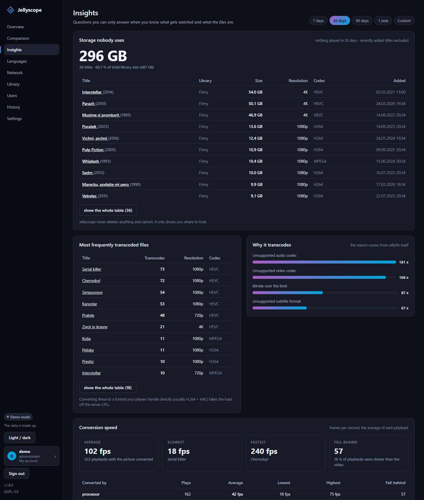
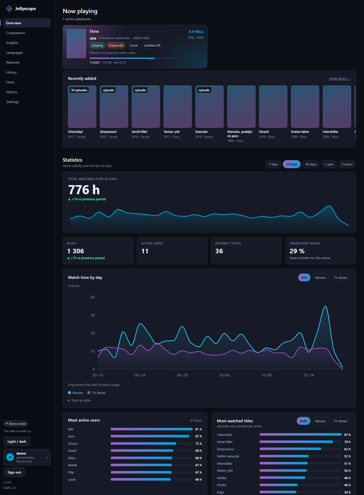
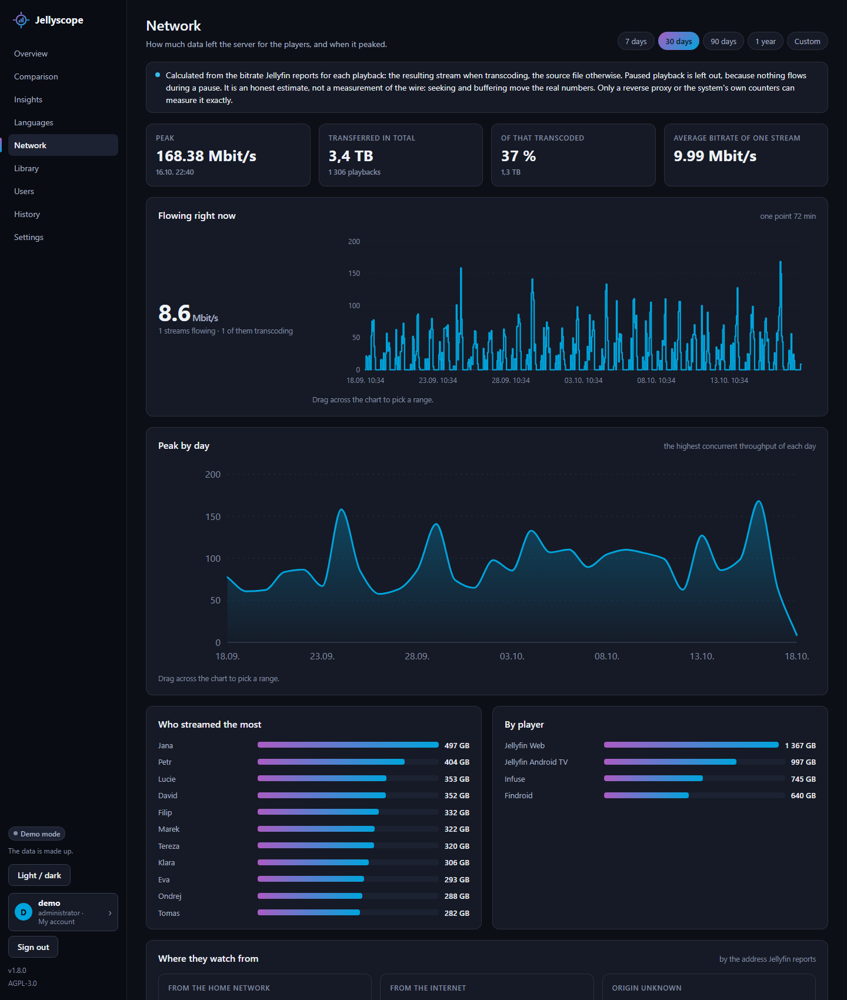
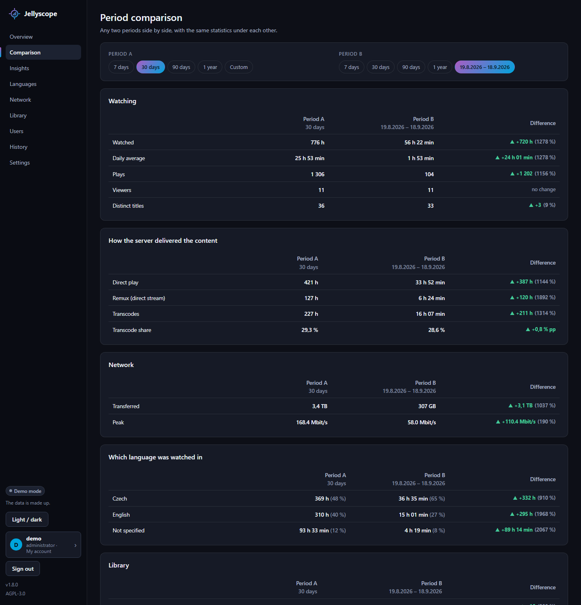
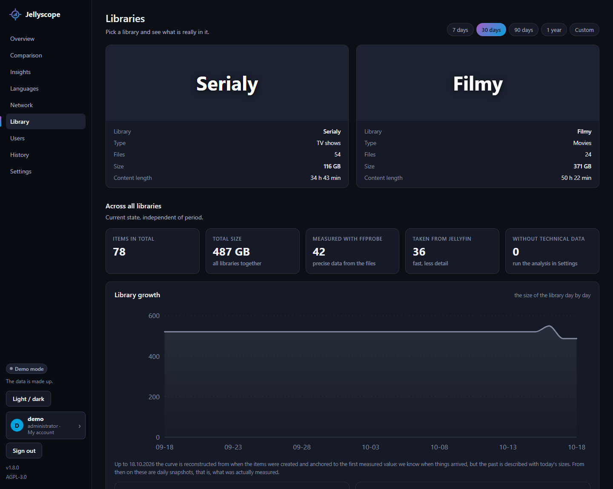
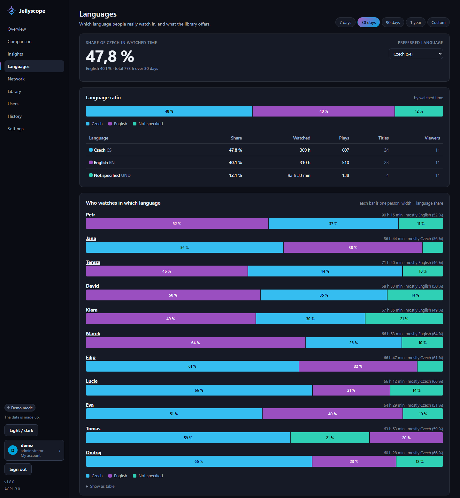
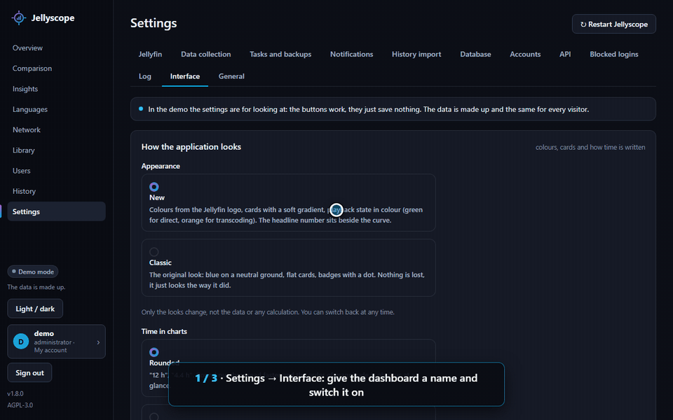

# Jellyscope

[](https://github.com/SpeeDFireCZE/jellyscope/actions/workflows/tests.yml)
[](LICENSE)
[](https://jellyscope.cz)
[](https://translate.jellyscope.cz/)
[](https://www.python.org/downloads/)

> [!NOTE]
> **Jellyfin 12 is supported**, and so is 10.x. Version 12 stopped
> accepting the old authentication headers and dropped the `/emby/` paths.
> Jellyscope has always used `Authorization: MediaBrowser Token="..."`,
> which 12 accepts and every older version understands. The server
> version is detected on its own, and *Settings → Jellyfin* can set it by
> hand for a server that behaves differently from what it reports.

Jellyfin statistics that **connect what people watch with the technical
state of the library**.

Inspired by two existing projects:

- **[Jellystat](https://github.com/CyferShepard/Jellystat)** knows *what is
  being watched*.
- **[MediaLyze](https://github.com/frederikemmer/MediaLyze)** knows *what
  those files are*.

Jellyscope copies neither. It implements both ideas independently in one
app, because together they answer questions that neither answers alone:

> "How many terabytes are taken up by content nobody has watched in a year?"
> "Which file makes the server transcode most often?"
> "What do I watch the most, and do I even have it in decent quality?"
> "Which 60 GB 4K film did I watch once and never again?"

---

## What it looks like

**Insights** is the page the whole project exists for. It puts behaviour
next to the technical data: how much space goes to things nobody watches,
which files make the server transcode, what you have in 4K and never
finished.



**Overview** shows what is playing right now, what was added, and the
numbers for the chosen period.



**Network** shows how much data left the server, when it peaked, and where
people watch from. Addresses from outside the home network are placed on a
map you can zoom into.



**Comparison** puts any two periods side by side, with the same statistics
under each: watching, how the server delivered it, network, languages and
what the library gained or lost.



| Library | Languages |
|---|---|
|  |  |
| Codecs, resolutions and sizes of what you really have. | What language people watch in, and what the library offers. |

<sub>The screenshots are from the demo mode, so the data is made up and the
posters are empty. A real installation loads them from Jellyfin.</sub>

The colours are Jellyfin's own: blue `#00A4DC` and purple `#AA5CC3`. If you
preferred the earlier look, **Settings → Interface** switches back to it.
The classic appearance restores the old colours and the old shapes, and you
can switch again whenever you like.

---

## What it does

| Page | Contents |
|---|---|
| **Overview** | Live playbacks, watched time, most active users and titles, transcode share, a "when do people watch" heatmap |
| **Comparison** | Any two periods side by side: watching, delivery, network, languages, library growth |
| **Insights** | Dead storage, most transcoded files, upgrade candidates, oversized files, possible duplicates |
| **Languages** | Language split in percent, who watches dubbed and who in the original, subtitles, titles with no track in the preferred language |
| **Network** | Throughput over time, volume transferred, home network against internet, a map of where people watch from |
| **Library** | A tile for each Jellyfin library, then a detail with Overview / Media / Activity tabs, then the file detail; day-by-day growth of the whole library |
| **Users** | Watch time per user, devices, individual detail |
| **History** | Every recorded playback, with language and links to the user and the title |
| **Shared dashboard** | A tab the administrator names and builds for everyone from the cards the other pages are made of; off until switched on |
| **My overview** | The same kind of tab, which each account builds for itself on *My account* and nobody else sees |
| **Settings** | Jellyfin connection, data collection, scheduled tasks and backups, notifications, history import, database, accounts, blocked logins, log, interface, general |

### Library and file detail

`/library` shows **a tile per Jellyfin library** with a poster, size and
title count. Opening one gives three tabs:

- **Overview**: codecs, resolutions and languages in this library
- **Media**: a poster grid with file size, sorting and search
- **Activity**: what was watched from this library, by whom and when

A tile opens the **file detail**: container, path, size, video track,
**every audio track with language and channel count**, **every subtitle**
(including the *forced* and *external file* flags), the playback history of
that title, and for episodes a list of the other episodes.

Each title has a **Reload metadata** button. It asks Jellyfin about that
one title, which helps after you fix wrong metadata in Jellyfin and do not
want to wait for the nightly sync.

Images are downloaded from Jellyfin **through Jellyscope** and cached on
disk, so the Jellyfin address and API key never reach the browser.

### Two sources of technical data, picked in Settings

The choice only affects **file details** (codec, resolution, bitrate, size):

- **Jellyfin API only**: we take what Jellyfin reports. It works right
  away and needs nothing extra.
- **ffprobe + Jellyfin**: files are read directly from disk. More accurate,
  but it needs ffmpeg installed and access to the files.

**Playback statistics always come from Jellyfin.** ffprobe can read a file,
but it cannot tell who watched what. The list of titles, users and
libraries comes from Jellyfin either way.

### Languages

Which language people actually pick, per user and per title, including
"they had a choice and picked Czech anyway" against "there was nothing
else". Titles whose audio track has no language code at all get their own
page, so you can fix the files rather than guess.

### Network

How much data left the server for the players, and when it peaked. The
throughput curve is not sampled: every playback adds its bitrate at its
start and takes it away at its end, so the curve follows the playbacks
exactly. Alongside it you get the volume transferred, the transcoded share,
the people and players that streamed the most, and a split of home network
against internet.

The numbers are an honest estimate, not a measurement of the wire:
seeking, buffering and pauses move the real numbers, and the page says so.

**The map** places public addresses with a GeoLite2 database: one file in
`data/`, downloaded with a button in Settings and queried offline. No
address of your viewers is ever sent anywhere, because the library that
reads that file (`maxminddb`, part of the installation) opens a local file
and never asks the network. Until the file is downloaded, the page explains
what is missing instead of showing an empty map. Addresses from the home
network are never placed, since `192.168.1.5` marks no spot on Earth.
Data © MaxMind, GeoLite2 (CC BY-SA 4.0).

### Comparison of two periods

"August against December" rather than "compared to the previous period".
There are two independent pickers, each with its own custom range, and the
same statistics under each other: watching, how the server delivered the
content, network, which language people watched in, and what the library
gained or lost.

The page says so when the two periods **overlap** or **differ in length**,
because a percentage between a week and a month compares nothing.

### Dashboards

Besides the fixed Overview there are two tabs you stack from cards. The
builder offers the cards of every statistics page, from the Insights
tables to the map. Only Comparison stays on its own page, because it needs
two periods.

- **The shared dashboard** is built by the administrator for everyone. It
  needs a name before it can be switched on (*Settings → Interface*), and
  the name then shows in the menu and as the page heading. An installation
  that already had the dashboard keeps it under its old name, "Custom
  overview". After a password sign-in it is the first page you see, as
  long as it holds a card you may see.
- **My overview** is built by each account for itself on *My account*,
  with no permission needed. Nobody else sees it.

Setting up the shared dashboard takes three steps: name it and switch it
on, pick the cards (each with a width of a third, a half or the whole
row), and save.



Cards follow access rights. The shared dashboard leaves out a card from an
area the account may not see, and its data is not even computed. My
overview keeps such a card in its place with a note that the permission is
missing, so it does not look broken, and the card comes back once the
administrator allows the area again. A tab with nothing in it for you
stays out of your menu; the administrator always has the shared one, to
build it.

### Library growth and free space

A daily snapshot of the library (size, title count) turns into a
**day-by-day curve** on the Library page, and the time before the first
snapshot is reconstructed from the dates titles were added. The
reconstruction is drawn in a different colour and the page says what it
is: we know when a title arrived, but its past is described with today's
sizes.

Alongside it you see how much arrived over the period, the daily average,
and **how long the free space will last**. Free space comes from Jellyfin
itself, because the data usually sits on a different machine than
Jellyscope. Where the library is in the cloud, not even Jellyfin knows its
size, so *Settings → Data collection* takes a capacity **entered by hand**
(in GB or TB) that takes precedence over everything else.

### Notifications

The application runs in the background and knows when something breaks,
but it needs somewhere to say so. *Settings → Notifications* has the
channels (**SMTP**, **Discord**, **Telegram**, each with a test button)
and three events that can be switched on and off separately:

- **the collector has stopped collecting**: nothing has been recorded for
  a while, so the history is quietly getting a hole
- **space is running out**, judged from the growth of the library and the
  free space that is known
- **a weekly summary**, on a day and at a time you choose

A message is only sent **when something changes**, including "it works
again", because people stop reading a watch that keeps repeating itself. A
problem and its end are two messages with their own wording. Every subject
and text can be rewritten on the same page; an empty field keeps the
default, which is shown in grey, and `{detail}` in a text is replaced by
the reason.

The page states one limit itself: nothing can tell you that Jellyscope is
not running, because Jellyscope would be the one sending it. That is a job
for an uptime monitor.

### Clearing out the history

A tool that records who watched what and when will sooner or later be
asked to forget some of it. *Settings → Tasks and backups* has a daily
**Clearing out the history** task. It deletes playbacks older than a limit
set beside it, and the page says how many rows that limit would remove
**before** anything is saved.

It is **off unless switched on**, and it stays off across updates, because
deleting data must never start on its own. Playback that is running is
never deleted. It belongs to the collector, which would only write it again
a moment later without its beginning.

The same section can **forget one viewer**: everything recorded about them
goes, and nobody else is touched. The account itself lives in Jellyfin, so
the next synchronisation sees it again, just without the history.

### The archive

Titles that disappear from Jellyfin are not deleted. They go to the
library's **archive**, so their history does not turn into nameless rows.
When a file comes back under a new id, Jellyscope finds it by its tmdb id
and the history follows on its own.

That fails when Jellyfin identified a title wrongly (say as *Behind the
scenes*) and created it again after the fix, with a new name, a new id and
nothing to match on. An archived item can then be **assigned to another
title** by hand: its history and statistics move to the chosen title and
the archived item is removed. This works for one item from its detail, or
for many at once from the archive view, each with a search in the live
library and a small poster beside every target. The bulk dialog first
shows a summary of what will move, and changes nothing until that summary
is confirmed.

What is not worth keeping can be **deleted** with its history: one title
from its detail, or many at once from the archive view. Tick the items
(each shows how many times it was played) or *Select all*, check the
summary and confirm. Only archived items of that library can go this way,
never a title that is still in the library. A database backup is taken
before every assignment or deletion.

### On a phone

Every page was measured at 320, 360 and 390 px, and none of them scrolls
sideways. The menu is a burger with the name of the open page, the Settings
sections are a dropdown, and wide tables turn into blocks or hide their
secondary columns. How many live streams (or viewers in the language
statistics) are shown outright is set **separately for a phone**, where a
card takes the full width.

### Scheduled tasks and backups

**Settings → Tasks and backups** has eight tasks:

| Task | When | What it does |
|---|---|---|
| Library sync | daily at a set time | Downloads users, libraries and titles. With ffprobe selected, an analysis of files without technical data follows. |
| Recently added titles | every N minutes | Only fetches what is not in the library yet. It barely touches Jellyfin, so it can run often. |
| Data tidy-up | daily at a set time | Asks Jellyfin about records that lead nowhere in the library, links them by name and episode number, merges duplicates and aligns names with the library. It deletes nothing. |
| Notifications | every N minutes | Checks whether the collector is collecting and whether space is running out, and sends the weekly summary on its day. |
| Check for updates | daily at a set time | Asks GitHub whether a newer release is out. It installs nothing, and it is off by default. |
| Clearing out the history | daily at a set time | Deletes playbacks older than the limit that is set. Off by default. |
| Database backup | daily at a set time | Saves a copy into the chosen folder and deletes surplus older ones. |
| Log rotation | daily at a set time | Every N days (7 by default) puts the application log and the API log aside and starts new ones. Keeps the set number of old ones (4 by default). |

Their default times follow that order. The tidy-up works on what the sync
has just fetched, and the backup then stores data that has already been
straightened out.

The same page also holds **File analysis** (reading technical data with
ffprobe, with its coverage) and the manual **Data tidy-up** button.

The nightly tasks run at a **time of day**, not at an interval. An interval
counts from the last run, so every manual run would push the schedule and
a 3:30 AM task would drift into the afternoon. A missed run (the machine
was off) is caught up after start, and a manual run never changes the
schedule.

Backups can be downloaded, deleted and restored from the same page.
Restoring saves the current state first, so a misclick costs nothing.
Logs work the same way: **Settings → Log** shows the application log or
the API log, either can be downloaded whole, and the older ones that Log
rotation put aside wait there for download until it deletes them.
SQLite backups use the built-in snapshot function rather than a file copy,
because a copy taken mid-write can be corrupt.

### Read-only API

Numbers for Grafana, Homepage or a script of your own. It only reads:
everything under `/api/` is a `GET`, and anything else is refused. The API
is a source of numbers, not a second way into the data.

**Settings → API** lists every key on the server. A key is shown
**once**, when it is made. What is stored is a hash and the first five
characters, so nobody, the page included, can read it back afterwards. If
you lose one, revoke it and make another; no other key is affected. You can
have one per tool, and the *last used* column shows which one nobody needs
any more.

**A key belongs to an account and can do exactly what that account can.**
A key made in Settings belongs to the admin who made it. Reader accounts
and Jellyfin viewers make their own on the **My account** page, once the
admin allows it: **Settings → Accounts → Own API keys** sets this for each
group, and the Rights dialog of one account can say yes or no for that
account alone. Such a key sees what its owner sees. An address in an area
the owner cannot open answers 403 (`/api/v1/` lists only the addresses the
key may use), other people's names and addresses are hidden when the owner
has anonymization on, and a viewer's key gets only the viewer's own
history: asking for someone else's with `?user=` is a 403. A viewer's key
also stops while sign-in through
Jellyfin is switched off or the viewer is disabled in Jellyfin. Taking the
permission away stops the key without deleting it, and giving it back makes
it work again. Keys made before keys
had owners keep full rights, so Grafana and Homepage go on working after
the update; the list marks them as *server key*.

The admin can **disable** any key, which stops it but keeps it with its
log so it can be enabled again, or **revoke** it for good. The owner can
only revoke their own.

**Usage log.** Every request with an existing key is written to the API
log (`data/logs/api.log`): when, the result (200, 403 and so on), the IP
address, which key and whose, and the address with its parameters.
**Settings → Log → API log** shows it with filters by user, key and IP
address, and only the admin sees it. On Settings → API, the links in the
key table open it already filtered. How long it is kept is up to the Log
rotation task. A request with an unknown key is not written down.

Errors come back as JSON with `detail`, a sentence, and `error`, a code a
tool can check: 401 for a missing or unknown key (`missing_token`,
`invalid_token`), 403 for a disabled key, an owner without the permission
and an address outside the owner's rights (`key_disabled`,
`key_not_allowed`, `area_not_allowed` and a few more), 404 for an unknown
title (`not_found`) and 400 for a malformed request (see *Filtering and
sorting* below).

The key travels in a header and never in the address, because the address
ends up in the proxy log, in the browser history and in the link somebody
forwards.

```bash
curl -H "Authorization: Bearer js_your_key" http://localhost:8097/api/v1/summary
```

| Address | What it returns |
|---|---|
| `GET /api/v1/` | The version and the list of addresses. |
| `GET /api/v1/summary?days=30` | Hours watched, plays, viewers, titles, transcode share, and how much is playing right now. |
| `GET /api/v1/now-playing` | What is playing: who, what, on what, transcoded or not, how far in. |
| `GET /api/v1/library` | Size of the library, item counts, free space, growth over a period. |
| `GET /api/v1/libraries` | Every library on its own: items, size, hours of content. |
| `GET /api/v1/top-items?days=30&limit=10&kind=both` | Most watched titles; episodes of a series add up. `kind` is `both`, `movies` or `series`. |
| `GET /api/v1/least-played?days=365&limit=25&min_size_mb=0&order=size` | Files from the least played up, never played first, with the last time each was played. Within the same play count the largest come first; `order=oldest` or `order=newest` sorts them by date added instead. Without `order` nothing changes. |
| `GET /api/v1/unwatched?days=365&limit=25` | What nobody watched over the period and how much space it takes, also as a share of the library. |
| `GET /api/v1/users?days=30` | Viewers and their watching over the period: hours, plays, titles, transcoded hours. |
| `GET /api/v1/history?days=30&limit=50&kind=both` | Recent playbacks, newest first. No IP addresses; the API never hands those out. |
| `GET /api/v1/recently-added?limit=18` | What came into the library last. |
| `GET /api/v1/play-methods?days=30` | Direct play against transcoding, and the clients people watch with. |
| `GET /api/v1/insights?days=30&limit=15` | The Insights page in numbers: transcode offenders, upgrade candidates, oversized and rarely watched, never finished, and the conversion speed in fps (average, slowest, fastest, by hardware). |
| `GET /api/v1/bandwidth?days=30` | Data sent out, the peak, transcode share, home against internet, and by country. Without addresses. |
| `GET /api/v1/item/<id>` | One title: the file, its versions and who watched it. |

Every item that is one file (least played, unwatched, recently added, one
title, and the oversized list in insights) carries its full `path` and
`tmdb_id`. For an episode `tmdb_id` is the series' TMDB id, since an
episode rarely has its own, and `season` and `episode` say which one it
is. Lists by title (top items, the other insights lists) have no single
file.

#### Filtering and sorting

Every list in an answer can be narrowed, sorted and cut by the fields it
already returns, so one address answers many questions:

```
GET /api/v1/least-played?path[starts_with]=/media/movies&sort=plays,added_at&limit=5
```

gives the five least played files under `/media/movies`, the oldest added
first when the play count is the same.

- **Filter:** `field[operator]=value`, one parameter per filter. All of
  them must match.
- **Sort:** `sort=field,-field`. A minus sorts descending; at most three
  fields; empty values always come last. Without `sort` a list keeps its
  usual order.
- **Limit:** `limit`, with the same defaults and caps as before.
- **Order:** filters first, then sorting, then the limit, always over the
  whole list, so the limit never cuts off what a filter is looking for.

| Field type | Operators | Value |
|---|---|---|
| text | `equals`, `not`, `contains`, `not_contains`, `starts_with`, `ends_with`, `in`, `empty` | any text up to 200 characters; case does not matter |
| number | `equals`, `not`, `gt`, `gte`, `lt`, `lte`, `in`, `empty` | `12` or `1.5` |
| time | `gt`, `gte`, `lt`, `lte`, `empty` | `2026-10-01` or `2026-10-01 18:30:00`, in UTC like the answer |
| bool | `equals`, `not` | `true` or `false` |

`in` takes values separated by commas (`type[in]=Movie,Episode`), and
`empty=true` finds fields without a value. `not` and `not_contains` also
match a field without a value; the other operators do not. A filter sees
what the key sees: names hidden from the key's owner cannot be found by
filtering for them either.

`/api/v1/insights` and `/api/v1/play-methods` return several lists, so a
field there carries the list name, and a list that no filter names comes
back unchanged. Called without filters, both answer as they always did.

```
GET /api/v1/insights?never_finished.best_percent[lt]=50&sort=-never_finished.attempts
GET /api/v1/play-methods?clients.hours[gte]=1
```

In `/api/v1/unwatched` a filter also narrows the totals (`count`,
`size_bytes`, `share_percent`), so `?path[starts_with]=/media/series`
says how much space the unwatched files in that folder take. `/api/v1/`
lists the fields and types of every list the key may use.
`/api/v1/summary`, `/api/v1/library` and `/api/v1/item/<id>` return one
object and take no filters.

**A malformed request is a 400, never default data.** An unknown
parameter, field, list or operator, a value of the wrong type, `days`
outside 1–3650, a `limit` over the cap, `order` together with `sort`:
each answers 400 with a code in `error` (`unknown_parameter`,
`unknown_field`, `unknown_list`, `unknown_operator`,
`operator_not_allowed`, `invalid_value`, `duplicate_parameter`,
`too_many`, `conflicting_parameters`, `not_filterable`), the `parameter`
it is about and, where it helps, the `allowed` values. Before, such a
request quietly got the default answer, which looked fine and was not
what had been asked for. The key is checked first, so without a valid key
the answer is 401 whatever the parameters say.

```json
{
  "detail": "Unknown field 'patth' in items. Fields: id, name, type, …",
  "error": "unknown_field",
  "parameter": "patth[contains]",
  "allowed": ["id", "name", "type", "…"]
}
```

Every answer has a fixed shape built from the same functions the pages
use, so a dashboard and the page it mirrors cannot drift apart. Row counts
are capped (500 at most, fewer where a page shows fewer, and a `limit`
over the cap is a 400), so a tool asking every few seconds cannot make the
server serialise the whole library each time.

```json
{
  "days": 30,
  "watched_hours": 647.0,
  "plays": 1066,
  "users": 11,
  "titles": 36,
  "transcode_share_percent": 29.6,
  "active_now": 1
}
```

The answers carry no CORS headers, so another site cannot read them from a
browser; the API is for tools running on a server. The same documentation
is in the application itself, behind the button in *Settings → API*.

### History and its filter

The history list has a filter whose parts combine: user, kind, a date
range, play method, player and language at once. All of it is in the
address, so a filtered view can be sent as a link.

### History import

Jellyscope only records playbacks while it runs. If you already have
history elsewhere, **Settings → History import** can take it over:

- **Playback Reporting**, a Jellyfin plugin. The data is read straight
  through Jellyfin, with no file to upload. A file upload is still there
  for when the plugin's API misbehaves.
- **Jellystat**: export a JSON backup and upload it.

Imports are **idempotent**: run one ten times and nothing is duplicated.

Imported data carries no audio language or transcode reason, because
neither tool stores them. Some Playback Reporting versions do record the
language, and those rows are counted.

Imported history often refers to titles by name only ("Episode 7"), which
matches nothing in particular. **Data tidy-up** (in *Settings → Tasks and
backups*) sorts that out in one action, and the daily task does it without
being asked:

1. Jellyfin is asked about the identifiers in the imported history. They
   are genuine, so it can name the series and the episode number the
   record is missing. A record hanging on a *series* id is narrowed down
   to one episode within that series.
2. What Jellyfin no longer knows is linked by name and episode number.
3. Duplicates are merged and names aligned with the library.

The steps always run in this order, which is why it is one button: the
lookup produces the links the rest works from.

Whatever is still left over is listed on **What could not be placed**,
grouped by reason, and can be assigned to a library title by hand.

### Accounts and signing in

The whole app is behind a login. On first open it asks you to create an
administrator account; more accounts are added in **Settings →
Accounts**.

Two roles:

- **administrator**: changes settings, runs tasks, manages accounts
- **reader**: sees statistics only, which suits most of a household.
  What reader accounts see can be narrowed down in Settings.

Passwords are stored as a hash (PBKDF2-SHA256, 600 000 iterations,
salted), never in readable form.

**My account.** The button with your name at the bottom of the menu
opens a page about your own account, available to everyone who is signed
in. A Jellyfin viewer sees their Jellyfin profile picture on it, which
Jellyscope does not store. There you build *My overview*, make your own
API keys if the administrator allows it, and pick
the interface language for your account alone; it takes precedence over
the server language in *Settings → General*, which stays the default for
everyone else. A local account can change its password there too, and
it asks for the current one first. Changing it signs that account out
everywhere else. A Jellyfin viewer changes the password in Jellyfin.

#### Signing in with a Jellyfin account

Anybody with a Jellyfin account can be let into Jellyscope with the same
username and password. Switch on **Enable Jellyfin sign-in** in
**Settings → Jellyfin → Viewer sign-in**. It stays off until you do,
because opening the household's statistics is your decision and an update
will not make it for you.

The password is never stored here, only passed to Jellyfin to check, and
the access token that check produces is revoked straight away. A Jellyfin
administrator is an administrator here too, and rights removed in Jellyfin
stop working here at the next sign-in.

Beside the switch is a tree of what a viewer sees. Their own statistics
and their own history are always visible, since that is what they signed
in for. Everything else is a tick box: insights and title charts, the
library, the server overview, period comparison, now playing, languages,
the viewer list, the network page. A family server can hide nothing, while
a server shared by people who should not see each other can hide a lot.
Local reader accounts have the same tree, set separately.

**Anonymising** goes with it: on the pages you do open, somebody else's
name reads `Viewer 3` and an IP address a dash. The number is stable, so
rows can still be compared, but it does not lead to a person. Nobody is
ever anonymised to themselves.

A page a viewer cannot open answers with a short page saying why. The rule
is an allow-list, so a page nobody thought about is closed rather than
open. The menu shows only what the person can open.

**One account can override its group.** The trees in Settings apply to a
whole group: Jellyfin viewers or local reader accounts. The **Rights**
button next to an account in *Settings → Accounts* gives that one account
rights of its own, with the same tree and the same anonymising switch,
saved on the account. From then on the group settings are not read for it
at all, and switching back to *as the group* drops the account's own tree.
An account with its own rights carries a badge in the list, so nobody
wonders why a group change did not reach it.

**A viewer removed from Jellyfin is removed here.** The account created at
their first sign-in disappears at the next sync (the quick one runs every
few minutes), and an open session ends with it. Only the sign-in goes. The
viewer's history and every statistic stay exactly as they were; forgetting
a viewer's data is a separate, deliberate action in *Settings → Tasks and
backups*. An empty answer from Jellyfin deletes nothing, because that is a
connection problem and not an empty server, and the last administrator
always stays.

#### Signing in with a code (Quick Connect)

Under the Jellyfin button is a second one: **Sign in with a code**. It
works the other way round from a password. Jellyscope shows a six-digit
code, you approve it in a Jellyfin you are already signed in to, and no
password is typed here at all. It needs Quick Connect switched on in the
Jellyfin Dashboard; when it is off, the page says so instead of failing
quietly.

The code alone lets nobody in. What finishes the sign-in is a secret that
stays in the session on the server and never reaches the browser, so a
code read over somebody's shoulder is worth nothing without the approval.
The token Jellyfin issues at the end is revoked straight away, the same as
with the password.

---

## Try it without Jellyfin

**[jellyscope.cz](https://jellyscope.cz)** is the whole app running on
made-up data. Sign in as `demo` / `demodemo` and click through everything.
Nothing there changes: every button that would write answers with a note
instead, so the demo is the same for the next visitor.

To run the same thing locally, with no server, no API key and nothing to
configure:

```bash
python3 -m venv .venv
.venv/bin/python -m pip install -r requirements.txt
.venv/bin/python demo.py
```

Open <http://127.0.0.1:8098> and sign in as `demo` / `demodemo`. It writes
into `data/demo.db`, so your real database (if you already have one) stays
untouched. It needs no `.env` and no API key, because `demo.py` sets
everything itself.

---

## Installation

### The installer (Linux)

On a Linux server one command does it:

```bash
sudo mkdir -p /opt/jellyscope
sudo chown "$USER" /opt/jellyscope
git clone https://github.com/SpeeDFireCZE/jellyscope.git /opt/jellyscope
cd /opt/jellyscope
bash deploy/install.sh
```

Another folder works too, since the installer fills the real paths into the
service configs it generates. Mind one thing: the systemd unit has
`ProtectHome=true`, so a service installed under `/home` cannot read its
own files. Either keep it out of `/home`, or delete that line from the
unit.

The script installs what is missing, creates the virtual environment,
writes `.env` with a generated key and prints how to hand the app over to
systemd or supervisord. The whole procedure (reverse proxy, HTTPS,
PostgreSQL, backups) is in **[DEPLOY.md](DEPLOY.md)**.

### Docker

```bash
git clone https://github.com/SpeeDFireCZE/jellyscope.git
cd jellyscope
cp .env.example .env
# SECRET_KEY is the one value the container refuses to start without:
sed -i "s|^SECRET_KEY=.*|SECRET_KEY=$(python3 -c 'import secrets; print(secrets.token_hex(32))')|" .env
docker compose up -d
```

Then open <http://localhost:8097> and create the first account. Everything
is configured in the same `.env` the app uses without Docker. The data
folder is mounted from the host, so a backup is a copy of a folder.

The application inside runs as UID 10001 and never as root. When the data
folder is **empty**, the container sets its owner on the first start, so
there is nothing to do. A folder that already holds something is left
alone, and if the application cannot write into it, every page says which
folder it is and what to run. Details, including a reverse proxy and
HTTPS, are in **[DEPLOY.md](DEPLOY.md)**.

Changing the code means rebuilding the image, because `docker compose up
-d` alone reuses the one that is already built:

```bash
git pull && docker compose up -d --build
```

### By hand

Python 3.11 or newer:

```bash
python3 -m venv .venv
.venv/bin/python -m pip install -r requirements.txt
cp .env.example .env
.venv/bin/python run.py
```

Open **<http://127.0.0.1:8097>**. The app asks you to **create an
administrator account**. Then go to **Settings → Jellyfin**, fill in the
address and an API key (Dashboard → Advanced → API Keys), test the
connection and run **Synchronise library**.

A **Restart** button sits at the top right of Settings, for changes that
are only read at startup.

### Configuration

`.env` holds only what the app needs *before* it can open the database:

| Key | Meaning |
|---|---|
| `SECRET_KEY` | Signs login cookies. Leave it empty and the app generates one into `data/secret_key`. |
| `HOST`, `PORT` | Where to listen. Default `127.0.0.1:8097`. |
| `DATABASE_PATH` | SQLite file. Default `data/jellyscope.db`. |
| `SECURE_COOKIES` | Turn on behind an HTTPS proxy. |
| `FORWARDED_ALLOW_IPS` | The proxy's address, so the app sees real client addresses. |

Everything else (the Jellyfin connection, data source, tasks, language) is
configured **in the app** and stored in the database.

`data/secret_key` belongs in your backups. Without it, everyone has to sign
in again after a restore.

### Database: SQLite or PostgreSQL

**Settings → Database.** The default is **SQLite**: the whole database is
one file, there is nothing to install, and it is plenty for a household.

**PostgreSQL** makes sense when you already run one. It needs the
`psycopg` driver:

```bash
.venv/bin/python -m pip install "psycopg[binary,pool]"
```

To switch, fill in the connection, then **Test connection**, **Copy data
into the selected database** (copies everything from the old database),
**Save and use after restart** and **Restart Jellyscope**.

Two safeguards: the settings are **not saved** until the connection works,
so you cannot lock yourself out, and the copy empties the target first, so
running it twice duplicates nothing.

The database settings are the one thing that does not live in the
database. They are in `data/database.json`, because they are what tells
the app how to connect.

### Interface language

**Settings → General → Language and time** sets the language of the
whole server: Czech, English or Spanish. Each account can pick its own on
the **My account** page, and the server language stays the default for
everyone who has not.

**The Spanish translation has not been checked.** I do not speak Spanish,
so nobody has proofread it. If something reads oddly or is simply wrong, a
correction is welcome, through Weblate or a pull request.
The application log has its own language setting, because a log is often
read by somebody else and English messages are easier to search for.

A missing translation falls back to English, so you never get a blank
spot. That is what makes a half-finished translation usable, and why one
is welcome: **adding a language is one file**, not a code change. The
sentences live in `jellyscope/translations/`, one JSON file per language,
and the list in Settings is built from whatever is in that folder; see
**[TRANSLATING.md](TRANSLATING.md)**.

Translating needs no git and no Python:
**<https://translate.jellyscope.cz/>** shows the Czech sentence with a box
for yours and sends the result to the repository on its own. A file and a
pull request work just as well.

### ffmpeg (optional)

Only needed for reading files locally. **`deploy/install.sh` installs it
for you**; the steps below are for when you skipped it with
`SKIP_FFMPEG=1` or installed by hand.

1. `sudo apt install ffmpeg`
2. In **Settings → Data collection**, switch the source to **ffprobe +
   Jellyfin** and fill in the path to `ffprobe` if it is not on `PATH`.
3. In **Settings → Tasks and backups → File analysis**, press
   **Analyse missing**.

---

## Important: history starts today

Jellyfin **does not keep** playback history. It can only tell you what is
playing right now, so Jellyscope asks every few seconds and builds the
history itself.

That means **there is no past data**. The Insights page becomes useful
after a few weeks of running, while the technical analysis of the library
works right away.

If you have history in Playback Reporting or Jellystat, import it; see
[History import](#history-import).

---

## Managing accounts from the command line

Mainly for when you cannot get into the app:

```bash
.venv/bin/python manage.py ucty            # list accounts
.venv/bin/python manage.py pridat jana     # add an account
.venv/bin/python manage.py pridat petr --spravce
.venv/bin/python manage.py heslo petr      # change a password
.venv/bin/python manage.py smazat jana
```

A forgotten password cannot be read back from the hash, by design. Set a
new one with `manage.py heslo <name>`.

---

## Security

By default the app listens on `127.0.0.1` only, so it is reachable from
that machine alone. That is deliberate.

To open it up to your network:

1. Give everyone else **reader** accounts, not administrator ones.
2. Set `HOST=0.0.0.0`.
3. Put a reverse proxy with HTTPS in front of it, and set
   `SECURE_COOKIES=1` and `FORWARDED_ALLOW_IPS`.

What the app does on its own:

- everything is behind a login; without an account you get nowhere
- passwords are stored as PBKDF2-SHA256 hashes (600 000 iterations, salted)
- a failed login does not reveal whether the name or the password was wrong
- signing in discards the old session (session fixation)
- repeated failed logins block that address, each block longer than the
  last (1, 2, 5, 15 minutes, then permanent); administrators can lift a
  block in **Settings → Blocked logins**
- when `SECRET_KEY` is not set, a random one is generated and stored,
  never a fixed value from the source code
- permissions are enforced on the server, not by hiding buttons
- the Jellyfin API key never leaves the server, and item ids from the URL
  are validated before they are used in a request to Jellyfin
- no third-party JavaScript and no CDN; the page never calls out to the
  internet
- every SQL query uses parameters, never string concatenation
- `ffprobe` runs without a shell, so a filename cannot become a command
- media files are only ever read; the app deletes and overwrites none of
  them
- the login cookie is signed and `SameSite=lax`; responses carry
  `X-Content-Type-Options`, `X-Frame-Options` and `Referrer-Policy`

---

## Project structure

```
jellyscope/
├── run.py                  launcher
├── demo.py                 demo mode with made-up data
├── manage.py               account management from the command line
├── requirements.txt        dependencies
├── .env                    your secrets (not in git)
├── deploy/                 installer, service configs, proxy examples
├── tests/                  the test suite (needs no Jellyfin)
├── data/                   database, logs, image cache (not in git)
└── jellyscope/
    ├── config.py           reads .env, generates the signing key
    ├── db.py               connection, migrations, settings cache
    ├── dialect.py          translates SQLite SQL to PostgreSQL
    ├── dbmigrate.py        copies data between the two databases
    ├── schema.sql          the shape of the database
    ├── accounts.py         accounts, passwords, login blocks
    ├── jellyfin.py         talking to Jellyfin
    ├── probe.py            ffprobe
    ├── languages.py        unifying language codes
    ├── collector.py        background playback collection
    ├── scanner.py          library sync + file analysis
    ├── tasks.py            scheduler and backups
    ├── odklizeni.py        clearing out the history, forgetting a viewer
    ├── pristup.py          what a viewer signed in from Jellyfin sees
    ├── notifikace.py       SMTP, Discord, Telegram
    ├── updates.py          asking GitHub about a newer release
    ├── importers.py        history import and its repairs
    ├── stats.py            statistical SQL queries
    ├── insights.py         behaviour meets technique ← the core idea
    ├── langstats.py        language statistics
    ├── sekce.py            the cards the dashboards are built from
    ├── charts.py           hand-drawn SVG charts
    ├── worldmap.py         the map on the Network page
    ├── geoip.py            the offline GeoLite2 lookup
    ├── formatting.py       numbers for humans
    ├── i18n.py             loads the translations, picks the language
    ├── translations/       one JSON file per language (+ log/)
    ├── applog.py           log file and its viewer
    ├── porucha.py          the page shown when the database will not open
    ├── api.py              the read-only API and its keys
    ├── api_dotaz.py        filters, sorting and checks for API requests
    ├── web.py              routes
    ├── web_zaklad.py       what every page needs: context, flashes, guards
    ├── web_nastaveni.py    the Settings routes, all thirty-six
    ├── demodata.py         generator of made-up data for the demo
    ├── templates/          HTML templates
    └── static/style.css    styling
```

**The comments in the source are in Czech.** The interface is in Czech,
English and Spanish and the documentation is in English, but the comments
are Czech only. They are long and explain *why* a thing is done that way,
usually by naming the bug that would happen otherwise, and translating
them would cost more than it would add. Pull requests with English
comments are welcome all the same; see [CONTRIBUTING.md](CONTRIBUTING.md).

---

## Versions and releases

The running version is in the bottom left corner and in *Settings →
General*. What changed in each version is in
**[CHANGELOG.md](CHANGELOG.md)**, and the release notes on GitHub are
taken from there.

Releases are tagged on GitHub as `1.2.3` (older ones as `v1.2.3`; both are
accepted). The tag has to match `__version__` in `jellyscope/__init__.py`,
and a workflow refuses to publish a release when it does not, because a
release nobody can identify is worse than none.

Jellyscope can watch for a new release: once a day it asks GitHub whether
a newer one is out and says so in the corner. It installs nothing, and it
is **off by default**. It is the only connection to anything other than
Jellyfin, so that is your call. Updating stays with `deploy/update.sh`.

---

## Common problems

| Problem | Fix |
|---|---|
| `ModuleNotFoundError` after a restart | The service runs the system Python. Use the full path to `.venv/bin/python`. |
| Nothing answers on `:8097` | `HOST=127.0.0.1` and you are connecting from another machine. |
| Collector reports 401 | Wrong API key. Create a new one in Jellyfin. |
| Collector reports a connection error | Wrong Jellyfin address, or Jellyfin is not running. |
| Analysis fails on every file | Jellyscope cannot see the paths Jellyfin reports. Set up Path mapping. |
| Insights page is empty | Not enough history yet. Let it run for a few days. |
| Charts and library are both empty | The library sync has not run yet. |
| Everyone was signed out | The signing key changed; see `SECRET_KEY` in [Configuration](#configuration). |
| In Docker, every page says the database cannot be opened | The mounted `data/` folder belongs to somebody else. On the host: `sudo chown -R 10001:10001 ./data && docker compose restart`. Only that folder, never the whole project, or the next `git pull` stops working. |
| In Docker, a change to the code does nothing | The image was not rebuilt: `docker compose up -d --build`. |

---

## Tests

Plain scripts, no pytest. Each one sets up its own temporary database, so
they need no Jellyfin, no network and no ffmpeg:

```bash
for t in tests/test_*.py; do .venv/bin/python "$t" || break; done
```

The same loop runs in GitHub Actions on Python 3.11 and 3.13 for every push
and pull request.

---

## Contributing

Bug reports and pull requests are welcome; please open an issue first for
anything bigger than a bug fix. How to run the app, how to write a test
that can actually fail, and what falls outside the scope of the project
are in **[CONTRIBUTING.md](CONTRIBUTING.md)**.

Translations are the easiest thing to contribute and need neither Python
nor git: **<https://translate.jellyscope.cz/>**. By hand, copy
`jellyscope/translations/cs.json`, translate the values and open a pull
request. **[TRANSLATING.md](TRANSLATING.md)** has the details.

Found a security hole? Do not open an issue; see
**[SECURITY.md](SECURITY.md)**.

---

## Licence

[AGPL-3.0](LICENSE). You are free to use, change and pass it on, and
whoever does must pass on the source too, including when they run a
modified version as a service over the network. That last part is why it
is AGPL and not plain GPL: Jellyscope is a web application, and plain GPL
would let someone host a closed fork without ever publishing anything.

Versions up to and including 1.5.1 were released under MIT and stay that
way, since a licence already given cannot be taken back.

The code is written independently. Nothing was taken from Jellystat or
MediaLyze apart from the idea of what is worth measuring.
